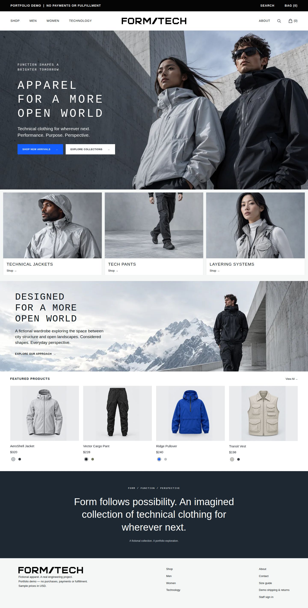

# FORM/TECH

A fictional technical-apparel commerce portfolio project. Database-backed storefront, guest demo checkout and protected staff management run locally. No payments, email, real shipping or fulfillment. Hosting selection and public deployment are deferred at the owner's request.

The authoritative scope is [FORM_TECH_REACT_PORTFOLIO_BUILD_SPEC.md](FORM_TECH_REACT_PORTFOLIO_BUILD_SPEC.md). Read [IMPLEMENTATION_STATUS.md](IMPLEMENTATION_STATUS.md) before continuing work.

The current storefront includes readable controls, reduced-motion-aware interactions, keyboard search suggestions, applied filter chips, per-product measurement dialogs, searchable size guides, related catalog pieces and tab-local recently viewed history. Product links can return to the exact listing and scroll position. See the [completed usability checklist and verification limits](docs/STOREFRONT_POLISH_CHECKLIST.md).

Men and Women now use [distinct curated selections](docs/COLLECTION_CURATION.md), with shared essentials and product-specific sizing guidance. Six new women’s designs lead Women and have their own capsule collection; the main catalog contains 30 products.

The [verified local release baseline](docs/RELEASE_BASELINE_2026-11-05.md) includes the rebuilt production preview at http://localhost:8082, the latest capsule and final responsive review. Development remains at http://localhost:8080.

## Architecture

One Laravel 13 application, Inertia 3, React 19, TypeScript, Tailwind 4 and PostgreSQL 17.11. The tested containers use PHP 8.4.27 and Node 24.22.2; the production web image uses Caddy 2.11.7. Laravel/Fortify provides staff-only sessions; public registration, resets, profile settings, two-factor and passkeys are disabled. Prices use USD integer minor units. Database sessions retain the guest bag for up to seven days of inactivity; cookie deletion or expiry loses that session.

The Laravel skeleton derives from the official `laravel/react-starter-kit` at commit `98d9b821baba4f4cc4120c96d35971366cec53e6` (MIT). The PHP development image uses the tracked official Sail runtime under `docker/development/`; see its provenance note. Exact application dependencies are in composer.lock and package-lock.json.

Editable source remains in this Windows/OneDrive folder. PHP and JavaScript dependencies inside Docker use Linux-backed volumes, reducing measured homepage response time from about 16 seconds to 2.4 seconds. These volumes contain reinstallable dependencies, not database records or a second editable source checkout. Production images bake in dependencies and do not use these development caches.



The UI refinement is verified locally: visible Home breadcrumbs, sticky white header, smooth/reduced-motion collection navigation, restrained feedback and closer reference proportions. Existing images, wordmark and demo commerce are preserved. Current screenshots are in `docs/screenshots/refinement-live-*.jpg`; production-image screenshots use `refinement-production-*.jpg`.

Responsive navigation has a documented [behavior contract and regression suite](docs/design/RESPONSIVE_BEHAVIOR.md). Run `docker compose exec -u sail laravel.test npm run test:responsive` after changing header styling or breakpoints; it checks Chromium, Firefox and WebKit across phone/tablet/desktop widths, touch layouts and rotation.

Mobile and staff screenshots are under `docs/screenshots/`. All 30 products are fictional. Each has two actual colorways (218 size/color variants). The 29 original generated photos, 24 approved color edits and 12 new capsule photographs are preserved with provenance; responsive WebP derivatives total about 8.16 MB. Clicking a dot updates its product photo and links to that color.

## Windows prerequisites

Docker Desktop must be running with the WSL2 backend and Ubuntu integration enabled. Use Ubuntu/WSL Bash for the commands below. Host PHP, Composer and Node are not required. PowerShell users can run the same Docker commands with the appropriate shell path syntax. Reopen terminals after Docker installation to refresh PATH.

## First setup: a clean checkout only

Do not overwrite an existing `.env` or regenerate an existing app key. From the project directory:

```bash
cp .env.example .env
```

Set a private `DB_PASSWORD` in `.env`. Never paste secrets into chat or commit them. Port 8080 avoids this machine's existing Apache server on port 80. Keep ports 5173/5432 free, or adjust `.env` and Vite configuration if they conflict.

Create the two external dependency volumes, then install locked PHP dependencies directly into the Linux volume. This avoids slow extraction of thousands of files into OneDrive:

```bash
docker volume create form-tech-apparel-php-deps
docker volume create form-tech-apparel-node
docker run --rm -e COMPOSER_HOME=/tmp/composer -v "$PWD:/var/www/html" -v form-tech-apparel-php-deps:/var/www/html/vendor -w /var/www/html laravelsail/php84-composer:latest composer install --no-scripts --no-interaction --prefer-dist
docker compose up -d --build
docker compose exec -u root laravel.test chown -R sail:sail /var/www/html/vendor /var/www/html/node_modules
docker compose exec -u sail laravel.test composer dump-autoload
docker compose exec -u sail laravel.test composer check-platform-reqs
docker compose exec -u sail laravel.test php artisan key:generate
docker compose exec -u sail laravel.test php artisan migrate
docker compose exec -u sail laravel.test php artisan db:seed
docker compose exec -u sail laravel.test npm ci
docker compose exec -u sail laravel.test npm run build:ssr
```

The Composer image only bootstraps dependency installation. The real application image must pass platform requirements and PostgreSQL tests. The first Sail image build downloads substantial development tooling; later startups reuse it.

First-time seeding checks campaign/catalog assets and creates the fictional products and content transactionally. Once homepage content exists, later seed runs leave the initialized store untouched, including renamed products/SKUs, stock, associations and merchandising edits. Seeding does not create an administrator, delete orders/messages, or reset inventory.

## Normal startup: this existing checkout

The current `.env`, app key, dependencies and database are already prepared. Use:

```bash
docker compose up -d
docker compose exec -d -u sail laravel.test php artisan inertia:start-ssr
docker compose exec -u sail laravel.test php artisan inertia:check-ssr
```

The renderer may take a moment to start before the check passes. Open [the local storefront](http://localhost:8080). Restart the renderer after rebuilding SSR assets so it loads the new bundle.

For asset hot reloading, run `docker compose exec -u sail laravel.test npm run dev` in a separate terminal. Stop it before final built-asset checks. PHP opcode caching validates source timestamps every two seconds, so PHP edits can take up to two seconds to appear. Source changes do not require rebuilding the image.

Shut down with `docker compose down`. Do not use volume deletion flags: they erase PostgreSQL storage. Dependency volumes are external and persist between app recreations. After dependency manifest changes, run Composer/npm installation inside the app and review updated lockfiles. Do not delete dependency volumes while containers use them.

## Staff bootstrap

Set `ADMIN_EMAIL` and a unique `ADMIN_PASSWORD` of at least 16 characters securely in the local/server environment, then run:

```bash
docker compose exec -u sail laravel.test php artisan app:bootstrap-admin
```

The command refuses to overwrite an existing account. For recovery of an existing administrator, supply the new credentials securely through the environment and run `php artisan app:recover-admin` in the app container. Recovery invalidates existing database sessions and remembered sign-ins. Remove ADMIN_PASSWORD afterwards, recreate the app to remove it from its process environment if necessary, and clear/rebuild cached configuration containing it. No default administrator exists in the working store; disposable browser-test credentials are generated only in the isolated test database.

## Checks

```bash
docker compose exec -u sail laravel.test npm run types:check
docker compose exec -u sail laravel.test npm run build:ssr
docker compose exec -u sail laravel.test npm test
docker compose exec -u sail laravel.test composer check-platform-reqs
docker compose exec -u sail laravel.test php artisan test
```

Tests use the separate PostgreSQL database `form_tech_testing`, never SQLite. Docker initialization creates it when the database volume is first initialized. For an existing volume missing that database, create it explicitly with PostgreSQL admin tooling; do not reset the volume. Test credentials come from local `.env` and must point only to the development server.

Backend coverage includes staff access, safe seeding, PostgreSQL constraints, storefront/contact/cart, checkout price/stock revalidation, snapshots, rollback, concurrent inventory and idempotency, protected catalog/content edits, private confirmation data and exactly-once cancellation. React tests exercise variant selection, stock/quantity limits, money, cart controls and filter submission.

Browser tests use the separate **disposable** `form_tech_e2e` database. Their guarded fixture runs `migrate:fresh` only there, generates a temporary staff password into ignored `.setup/`, and leaves the working store untouched. Never point them at the app/production database. If an older development volume is missing it, create this database once with the PostgreSQL role inside the database container; do not reset the volume.

```bash
# Only if this test database is absent:
docker compose exec pgsql sh -c 'createdb -U "$POSTGRES_USER" form_tech_e2e'

# Install after a development-container recreation; no host browser installation is needed:
docker compose exec -u root -e PLAYWRIGHT_BROWSERS_PATH=/opt/form-tech-browser laravel.test npx playwright install --with-deps chromium
docker compose exec -u sail laravel.test npm run test:e2e
```

Playwright temporarily serves the testing app on localhost:8081, runs a guest checkout, zero-result search, staff edit/cancellation, unauthorized redirect, mobile menu and required-width checks, then stops that test server. Traces and credentials are ignored and excluded from production images. The normal store remains at localhost:8080.

Run `npm run images:optimize` inside the container only when approved source assets change; commit responsive derivatives and `resources/js/image-manifest.json` together. External admin-associated URLs fall back to their original image without a server-side fetch. Browser evidence and remaining release gates are recorded in IMPLEMENTATION_STATUS.md.

## Production preparation

Production images have been built and run locally with debug disabled, compiled browser/SSR assets, PHP-FPM/Caddy, a separate Node renderer, private PostgreSQL, encrypted database sessions and persistent data/TLS storage. All four service health checks pass. A complete fictional checkout/contact save and a backup/restore into a new database were rehearsed locally. No public deployment or public HTTPS verification has occurred.

See [the deployment runbook](docs/DEPLOYMENT_RUNBOOK.md) for production setup, secure staff bootstrap/recovery, backups, retention and rollback. The local-only rehearsal uses an ignored `.env.release-check` and a separate Compose project/database:

```bash
docker compose -p form-tech-release --env-file .env.release-check -f compose.production.yaml -f compose.release-check.yaml up -d
# Local HTTP preview: http://localhost:8082 (only while that rehearsal stack is running).
docker compose -p form-tech-release --env-file .env.release-check -f compose.production.yaml -f compose.release-check.yaml down
```

The HTTP/cookie override in `compose.release-check.yaml` is never a public-deployment configuration. Hosting/domain selection, GitHub destination, real-host HTTPS, protected off-host backups, an approved retention period and explicit publication approval remain prerequisites. The owner requested help choosing hosting later.

The visual reference, generated images and exact image-generation prompts are recorded under `docs/design/`. Preserve source assets and provenance when adding responsive derivatives.

For an existing database, run `php artisan migrate` and then `php scripts/add-catalog-colorways.php` inside the application container. The additive command is repeatable and preserves merchant edits, stock, prices and orders. Fresh seeding includes both colorways; never reset the working database to apply this update.
